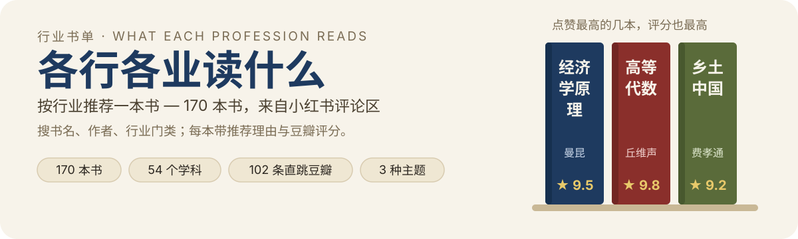
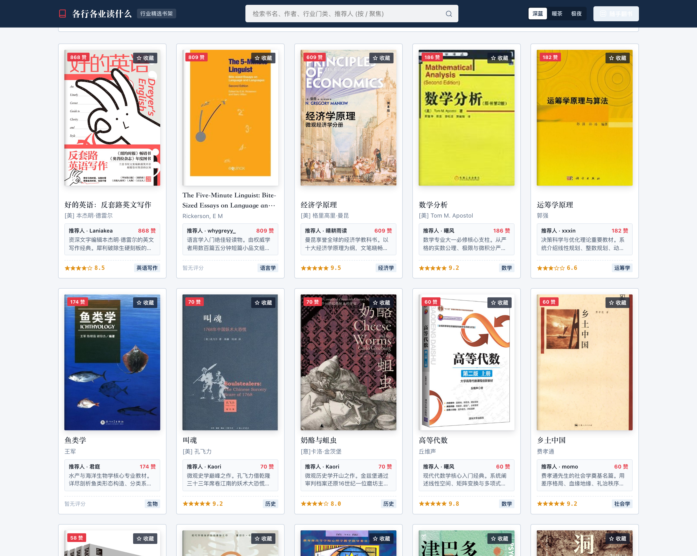

<p align="right"><a href="README.md">中文</a></p>

<p align="center">
  
</p>

<p align="center">
  <a href="https://holynova.github.io/industry-book-recommender/">▶ Browse Online</a>
  ·
  <a href="https://github.com/holynova/industry-book-recommender">GitHub Repository</a>
</p>

Industry Book Recommender ("各行各业读什么" — what each profession reads) puts 170 books from 54 fields on one shelf, sourced from 578 parsed Xiaohongshu comments — search by title, author, field, or recommender; filter by subject; sort by likes or rating. Every book carries its recommender's own words, a Douban rating, and a verified cover, with a 「在豆瓣查阅」 ("View on Douban") link to its Douban page or search.

## Screenshot

<p align="center">
  
</p>

## Features

- **Search**: titles, authors, fields, and recommenders, all at once (press `/` to focus the search box).
- **Subject filters**: 54 subjects — history 13 books, psychology / law 12 each, philosophy 10, computer science 9, medicine 8…
- **Sorting**: by likes, mentions, rating, or title. The most-liked book is 《好的英语：反套路英文写作》 (868 likes).
- **Random pick**: flip a random book when you don't know what to read.
- **Bookmarks**: tap ☆ on a card to save it locally.
- **Detail popup**: tap a card for the full recommendation, edition info, and Douban link.
- **3 themes**: deep blue, warm tea, and polar night.

## Data

The list comes from 578 parsed unique comments and 170 book candidates in the sibling project `xhs-book-comments`. The sample doesn't cover all comments, and some candidates come from comment-thread summaries — this is not a complete must-read list for any professional field.

### Edition & Cover Verification

Cover, edition info, and rating must come from **the same edition of the same book** — otherwise a card shows the right title with the wrong cover. Every entry was verified as follows (numbers measured from `src/data/books.json`):

- 102 entries have a unique Douban page, and 「在豆瓣查阅」 jumps straight to it; the rest fall back to a Douban search by title + author. Devices with a fine pointer and hover get desktop Douban; everything else defaults to mobile Douban.
- 148 entries have ratings: Douban scores and WeRead reference scores are labeled separately, so books with WeRead covers never pose as Douban-rated.
- Douban entries are matched on title + author (title similarity ≥ 0.8, author similarity ≥ 0.4); unmatched entries are left as-is and logged, never guessed.
- 169 entries have a cover image (local `public/covers/`).

### Known Data Limits

- `#165 Polygen mesh processing` is not a book — it's a geometry-processing open-source library with its paper. The card says so, and it has no cover.
- Some medicine, geoscience, and management textbooks (e.g. 《生理学》, 《电路》, 《系统解剖学》) have no Douban cover image; only their edition info could be confirmed, with no rating.

## Run Locally

```sh
npm install
npm run dev
```

Build and check: `npm run lint`, `npm run build`.

## Data Maintenance

```sh
node scripts/fetch_covers.js          # Incremental verification: only fills in missing or mismatched entries
node scripts/fetch_covers.js --force  # Full re-verification (re-fetches every cover)
```

The script skips entries that already have a `doubanUrl`, so it is safe to run repeatedly.

## Tech

- React 19 + Vite 8 + plain CSS, zero UI framework; data is static `src/data/books.json`, pure client-side computation, no backend.
- Covers are stored locally: 169 covers in `public/covers/`, with no dependency on Douban's image service.

```
src/App.jsx              The whole site: search / filters / sorting / bookmarks / detail popup / themes
src/data/books.json      170 book entries
public/covers/           169 local covers
scripts/fetch_covers.js  Cover and edition verification script
```
