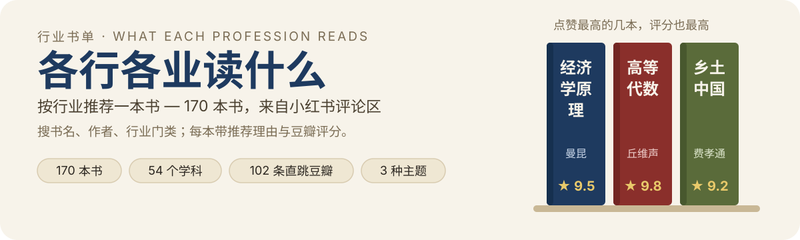
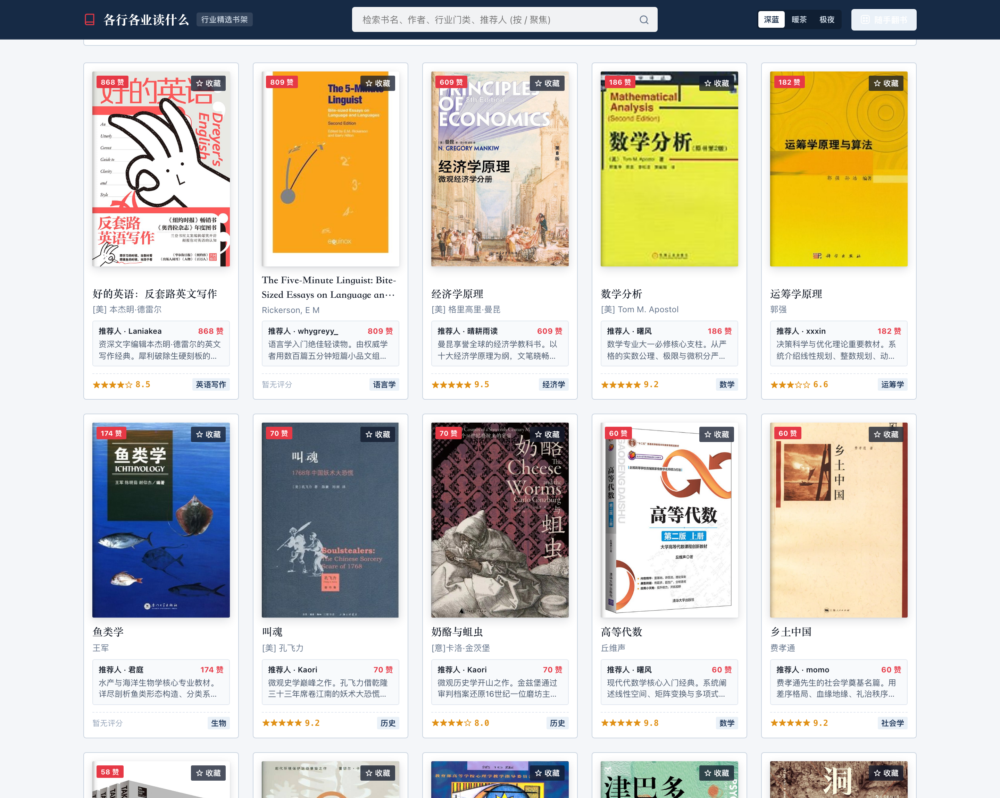

<p align="center">
  
</p>

<p align="center">
  <a href="https://holynova.github.io/industry-book-recommender/">▶ 在线浏览 Browse Online</a>
  ·
  <a href="https://github.com/holynova/industry-book-recommender">GitHub 仓库</a>
</p>

各行各业读什么：按行业推荐一本书。170 本书、54 个学科，一次全部展示——搜书名、作者、行业门类或推荐人，点学科筛选，按点赞或评分排序。每本书都带推荐人的原话理由、豆瓣评分与封面，点「在豆瓣查阅」直达条目或搜索页。

What does each profession read? 170 books across 54 fields, all on one shelf — search by title, author, field, or recommender; filter by subject; sort by likes or rating. Every book carries its recommender's own words, a Douban rating, and a verified cover, with a link to its Douban page or search.

## 截图 / Screenshots

<p align="center">
  
</p>

## 功能 / Features

- **搜索**：书名、作者、行业门类、推荐人，一次搜全（按 `/` 聚焦搜索框）。
- **学科筛选**：54 个学科，历史 13 本、心理学 / 法学各 12 本、哲学 10 本、计算机 9 本、医学 8 本……
- **排序**：按点赞数、提及次数、评分或书名排；点赞最高是《好的英语：反套路英文写作》（868 赞）。
- **随手翻书**：随机翻一本，不知道读什么时用。
- **收藏**：点卡片上的 ☆ 收藏，本地保存。
- **详情弹窗**：点卡片看完整推荐理由、版次信息与豆瓣链接。
- **3 种主题**：深蓝、暖茶、极夜。

## 数据 / Data

书目来自相邻项目 `xhs-book-comments` 中已解析的 578 条唯一评论和 170 条书目候选。样本未覆盖全部评论，且部分候选来自评论区汇总，不构成专业领域的完整必读书单。

### 版本与封面核验

封面、版本信息、评分必须来自**同一本书的同一个版次**，否则卡片就会出现「书名对、封面不对」的张冠李戴。为此每条书目都经过如下核验（数字以 `src/data/books.json` 实测为准）：

- 102 条有唯一豆瓣条目，「在豆瓣查阅」直跳该书页面；其余退回书名 + 作者的豆瓣搜索页。带精细指针与悬停能力的设备用桌面版豆瓣，其余默认移动版。
- 148 条有评分：豆瓣分与微信读书参考分分开标注，微信读书封面的书目不冒充豆瓣分。
- 豆瓣条目通过书名 + 作者双重匹配（标题相似度 ≥ 0.8、作者相似度 ≥ 0.4），匹配不上的条目保持原样并记录日志，绝不猜。
- 169 条有封面图（本地 `public/covers/`）。

### 已知的数据边界

- `#165 Polygen mesh processing` 并非图书，而是几何处理开源库与配套论文，卡片已注明，无封面。
- 部分医学、地学、管理学教材（如《生理学》《电路》《系统解剖学》）在豆瓣无封面图，仅能确认版次信息，无评分。

## 本地运行 / Run Locally

```sh
npm install
npm run dev
```

构建与检查：`npm run lint`、`npm run build`。

## 数据维护 / Data Maintenance

```sh
node scripts/fetch_covers.js          # 增量核验：只补缺失或错配的条目
node scripts/fetch_covers.js --force  # 全量重新核验（会重抓所有封面）
```

脚本默认跳过已有 `doubanUrl` 的条目，因此可以安全地反复运行。

## 技术 / Tech

- React 19 + Vite 8 + 本地 CSS，零 UI 框架；数据是静态 `src/data/books.json`，前端纯计算，无后端。
- 封面本地化：169 张封面存在 `public/covers/`，不依赖豆瓣图片服务。

```
src/App.jsx              全站：搜索 / 筛选 / 排序 / 收藏 / 详情弹窗 / 主题
src/data/books.json      170 条书目数据
public/covers/           169 张本地封面
scripts/fetch_covers.js  封面与版次核验脚本
```

## English

**Industry Book Recommender** ("各行各业读什么" — what each profession reads) puts 170 books from 54 fields on one shelf, sourced from 578 parsed Xiaohongshu comments.

- **Search** titles, authors, fields, or recommenders (press `/` to focus); **filter** by subject; **sort** by likes, mentions, rating, or title; **random-pick** a book; **bookmark** favorites locally.
- **Verified editions**: cover, edition info, and rating must come from the same edition of the same book — 102 books link straight to their Douban entry, the rest fall back to Douban search; 148 have ratings, with Douban scores and WeRead reference scores labeled separately.
- **Known limits**: entry #165 (Polygen mesh processing) is a geometry-processing library, not a book, and is labeled as such; some textbooks have no Douban cover or rating.
- **Tech**: React 19 + Vite 8 + plain CSS, static JSON data, 169 covers stored locally. `npm install && npm run dev`.

## 许可 / License

仓库未附 LICENSE 文件。No license file is included in this repository.
